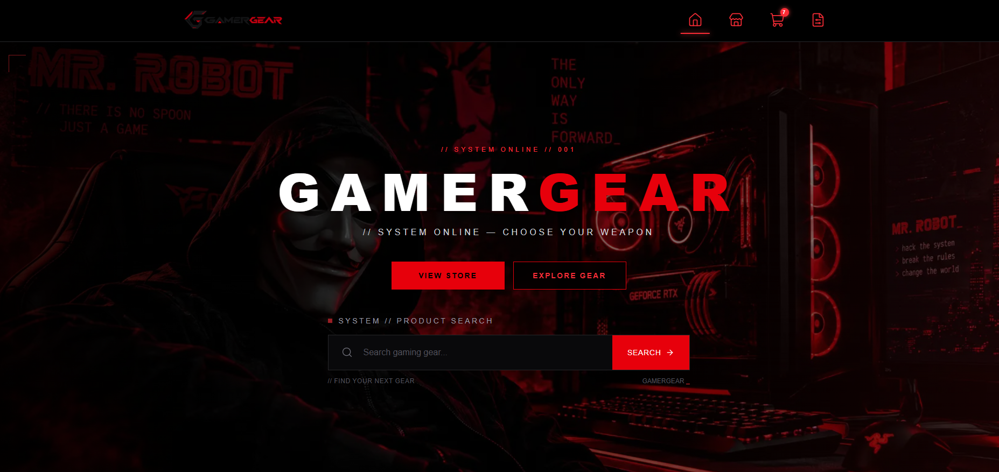
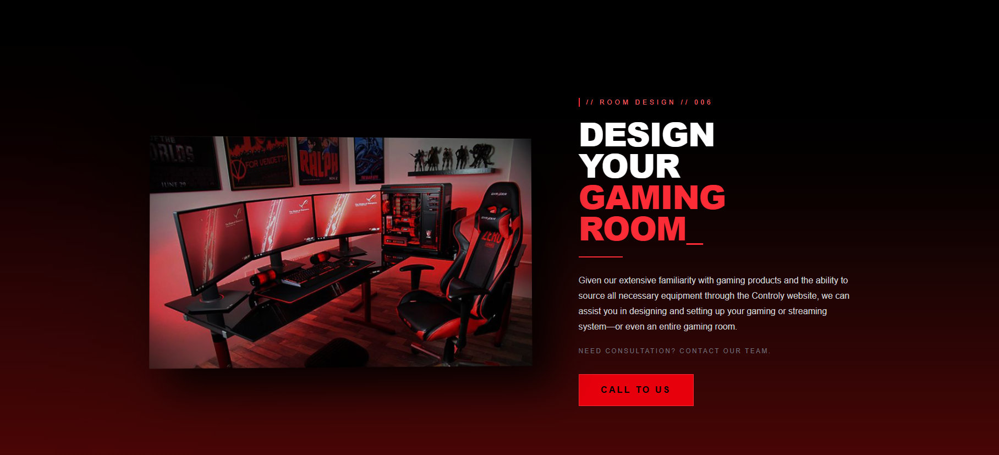
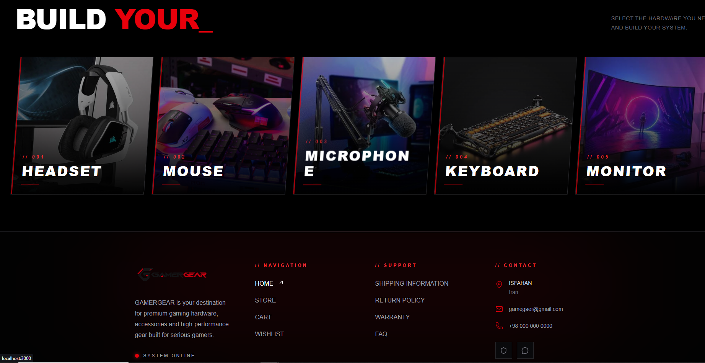
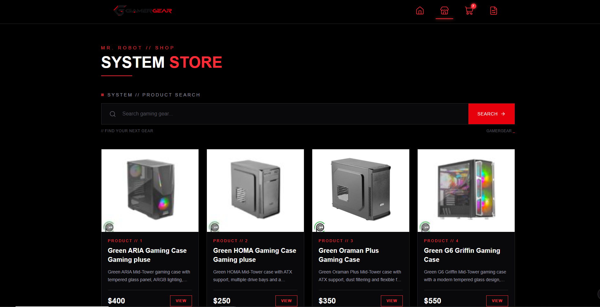
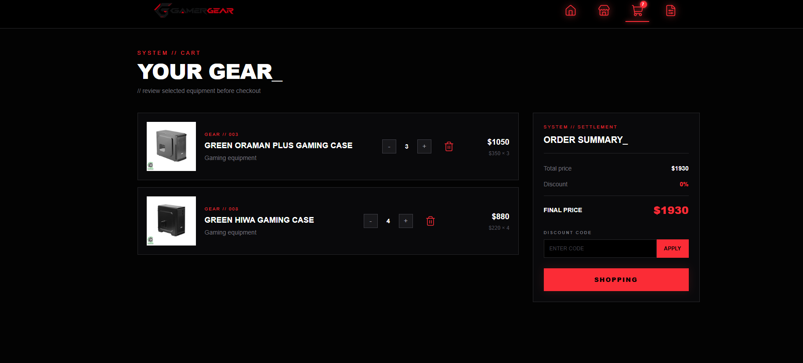

# 🎮 GAMERGEAR

### A Gaming Accessories Store Built with Next.js

GAMERGEAR is a gaming accessories e-commerce project built with Next.js, React, and Tailwind CSS. It focuses on creating a modern, responsive shopping experience with reusable components and essential e-commerce functionality.

## 🚀 Features

- 🛍️ Product listing and product detail pages
- 🔎 Product search
- 📂 Category-based product browsing
- 🛒 Shopping cart functionality
- 📦 Checkout and order form interface
- 📱 Responsive user interface
- 🧩 Reusable React components
- 🔌 Local API integration using JSON Server

## 🛠️ Tech Stack

- **Next.js** — React framework
- **React** — Component-based UI development
- **JavaScript & TypeScript** — Application logic and type safety
- **Tailwind CSS** — Responsive styling
- **JSON Server** — Local development API
- **Axios** — HTTP requests
- **Git & GitHub** — Version control and source code hosting

## 📸 Screenshots

### Homepage — Hero Section



### Homepage — Products



### Homepage — Footer



### Product Details



### Shopping Cart


## ⚙️ Getting Started

### Prerequisites

Make sure you have the following installed:

- [Node.js](https://nodejs.org/)
- npm (included with Node.js)

### Installation

1. Clone the repository:

   ```bash
   git clone https://github.com/Hossein-rafiee-esf/GAMERGEAR.git
   ```

2. Navigate to the project directory:

   ```bash
   cd GAMERGEAR
   ```

3. Install the dependencies:

   ```bash
   npm install
   ```

### Run the Application

GAMERGEAR uses JSON Server to provide local product and order data. You need to run the API and Next.js development server in two separate terminals.

**Terminal 1 — Start JSON Server**

```bash
npm run server
```

The local API will be available at:

`http://localhost:8000`

**Terminal 2 — Start Next.js**

```bash
npm run dev
```

Open the application in your browser:

`http://localhost:3000`

### 🗄️ Sample Database

The repository includes `db.example.json`, which provides sample product data for local development.

The `npm run server` command starts JSON Server using this sample database. The sample database contains product records and an empty order list.

**Important:** The local `app/db.json` file is excluded from Git to help prevent private development data from being committed.

The sample database is intended for development and demonstration purposes only. It is not configured as a production database.

## 👨‍💻 Developer

**Hossein Rafiei**

Front-End Developer focused on React, Next.js, and modern web development.

- GitHub: [@Hossein-rafiee-esf](https://github.com/Hossein-rafiee-esf)
- Project Repository: [GAMERGEAR](https://github.com/Hossein-rafiee-esf/GAMERGEAR)

---

*Built as a front-end development learning project.*
